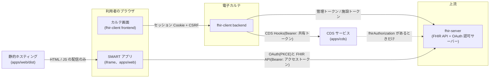
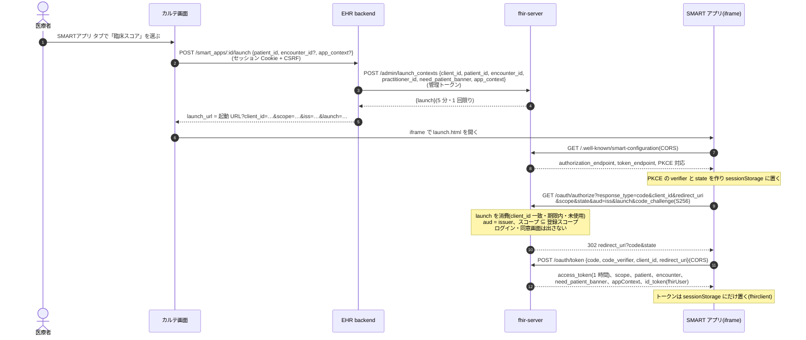
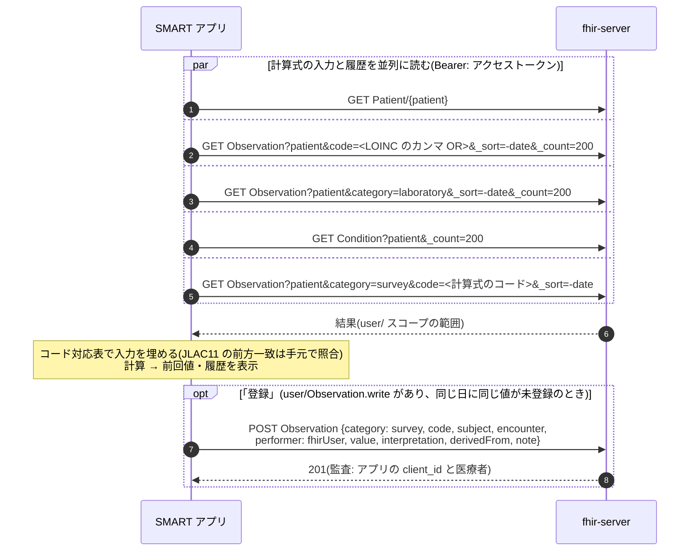
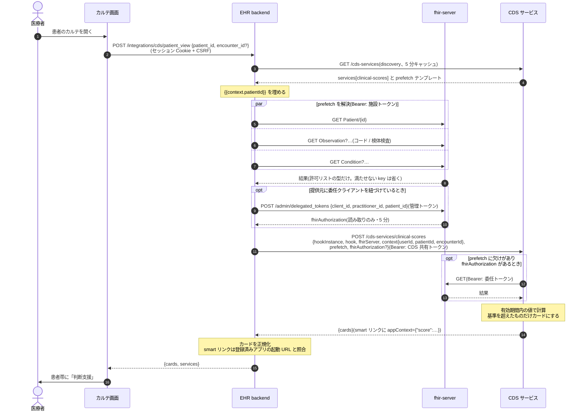
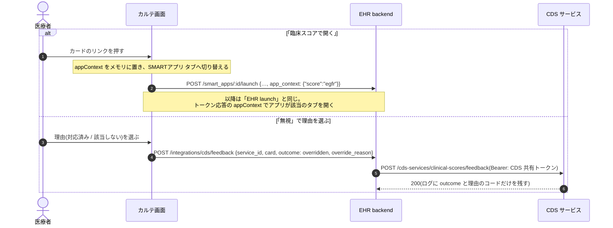

# 認証・認可とデータ取得の流れ

SMART アプリ(`apps/web`)と CDS サービス(`apps/cds`)が、電子カルテ(fhir-client)と上流 FHIR サーバー(fhir-server)の間で
どう認証・認可され、どこからデータを読むかをまとめる。EHR 側の設計は fhir-client の `docs/smart-app-launch-design.md` と
`docs/cds-hooks-design.md` が正典。

## 登場するもの

- SMART アプリは EHR の backend を通らず、上流と**ブラウザから直接**やり取りする。EHR の役目は launch の発行だけ。
- CDS サービスは EHR の backend からだけ呼ばれる。患者データは backend が prefetch で同梱して渡す。
- 静的ホスティングは HTML と JS を配るだけで、患者データは通らない。

## 使う資格情報

| 資格情報 | 持ち主 → 相手 | 寿命 | 用途 |
|---|---|---|---|
| セッション Cookie + CSRF | カルテ画面 → EHR backend | ログイン中 | 利用者(医療者)の認証 |
| 管理トークン(`X-FHIR-Admin-Token`) | EHR backend → 上流 | 固定(環境変数) | launch の発行(`/admin/launch_contexts`)、委任トークンの発行 |
| 施設トークン(SMART Backend Services、`system/`) | EHR backend → 上流 | 短命(`client_credentials` で取得) | 画面の中継と CDS の prefetch の FHIR 読み取り |
| launch トークン | 上流 → EHR → SMART アプリ → 上流 | 5 分・1 回限り | 起動の文脈(患者・受診・医療者・appContext)の受け渡し |
| 認可コード | 上流 → SMART アプリ | 5 分・1 回限り | トークンとの交換(PKCE の verifier と組) |
| アクセストークン(`user/`) | 上流 → SMART アプリ | 1 時間 | SMART アプリの FHIR 読み書き。登録スコープの範囲だけ |
| id_token | 上流 → SMART アプリ | — | `fhirUser`(ログイン中の医療者 `Practitioner/{id}`) |
| CDS 共有トークン(`CDS_AUTH_TOKEN`) | EHR backend → CDS | 固定(環境変数) | CDS サービスの呼び出し元の確認 |
| 委任トークン(`fhirAuthorization`) | 上流 → EHR → CDS | 5 分・読み取りのみ | CDS が prefetch で足りない分を自分で読む(提供元に委任クライアントを紐づけたときだけ) |

## SMART アプリ: EHR launch

- **誰として認可されるか**: 医療者の本人確認は EHR のログインで済んでいる。上流は「管理トークンを持つ EHR が名乗った医療者」を信頼し、
  launch に `practitioner_id` を結びつける。上流側にログイン画面は無い。
- **何が許されるか**: 上流の OAuth クライアント登録のスコープが上限。アプリは起動 URL の `scope` で要求し、超えると `invalid_scope`。
  既定は読み取りだけで、書き戻す配布では `user/Observation.write` を登録と起動 URL の両方に足す。
- **断られるもの**: `offline_access`(長期の refresh)、`_history`・`AuditEvent`・`$export`(`user/` では 403)。
- **再読み込み**: launch と認可コードは 1 回限りなので、トークン取得前に iframe を再読み込みすると失敗する。カルテの「再起動」で新しい launch を出す。
  トークン取得後は fhirclient が sessionStorage から復元する。
- **React StrictMode**: `ready()` が 2 回走ると認可コードの二重交換で `invalid_grant` になるので、`smart/session.ts` で 1 回に限っている。

## SMART アプリ: データの取得と書き戻し

- 読む範囲: `user/` のトークンは患者コンパートメントに閉じない(施設内の全患者を読める)。アプリは起動時の `patient` だけを読む。
- 検索の組み立ては `packages/scores/src/queries.ts` と `history.ts` に置き、CDS の prefetch と共有する。

## CDS サービス: patient-view

- **CDS が見る範囲**: 既定は backend が同梱した prefetch だけ。`fhirServer` の URL は届くが、委任トークンが無ければ上流は読めない。
- **呼び出し元の確認**: `CDS_AUTH_TOKEN` を設定すると、Bearer が一致しない呼び出しを 401 で断る(discovery は誰でも読める)。
- **失敗したとき**: 提供元が落ちている・10 秒を超える場合は、その提供元のカードが出ないだけでカルテは開ける。
- **ログ**: CDS サービスはサービス id・カード数・所要時間だけを出し、患者を特定できる値は出さない。

## CDS のカードから SMART アプリへ・無視の理由

## 本番で確認すること

- SMART アプリと CDS サービスは https で配信する(EHR は本番で http の起動 URL・CDS の URL を受け付けない)。
- SMART アプリは `Content-Security-Policy: frame-ancestors <EHR のオリジン>` を応答ヘッダーで出し、`X-Frame-Options` は出さない。
- CDS サービスには `CDS_AUTH_TOKEN` を設定し、EHR の管理画面「CDS サービス」の認証トークンに同じ値を入れる。
- CDS サービスの `SMART_APP_LAUNCH_URL` を、EHR に登録した SMART アプリの起動 URL(クエリを除く)と一致させる。
- CDS サービスは患者データ(prefetch)を受け取るので、置き場所(国内のサーバーが要るか)を施設の方針で確認する。
